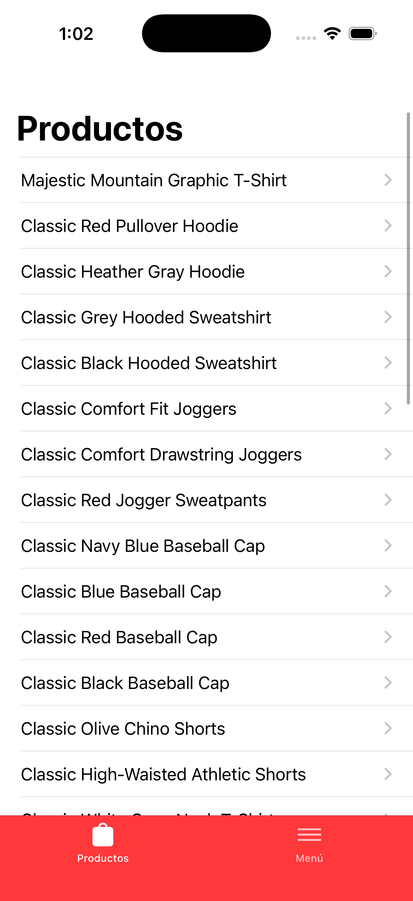
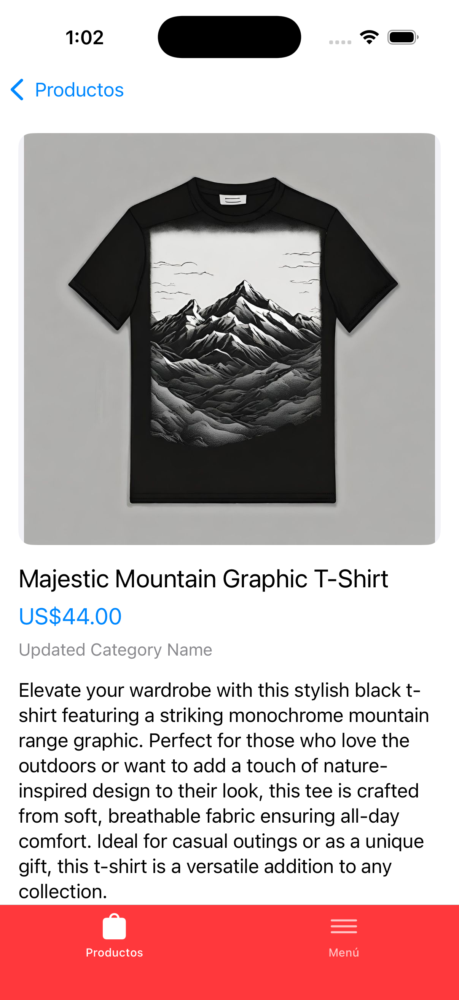
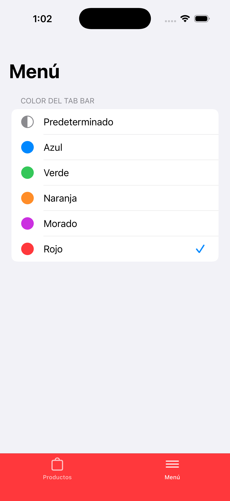
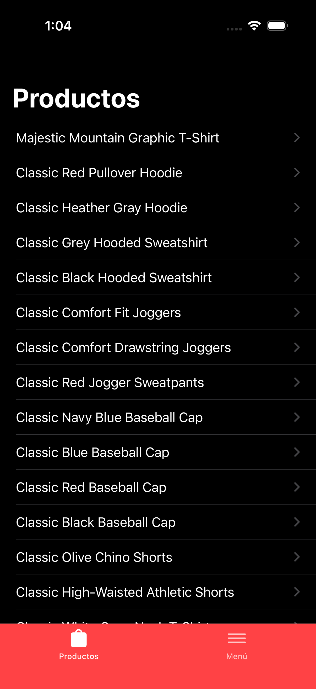
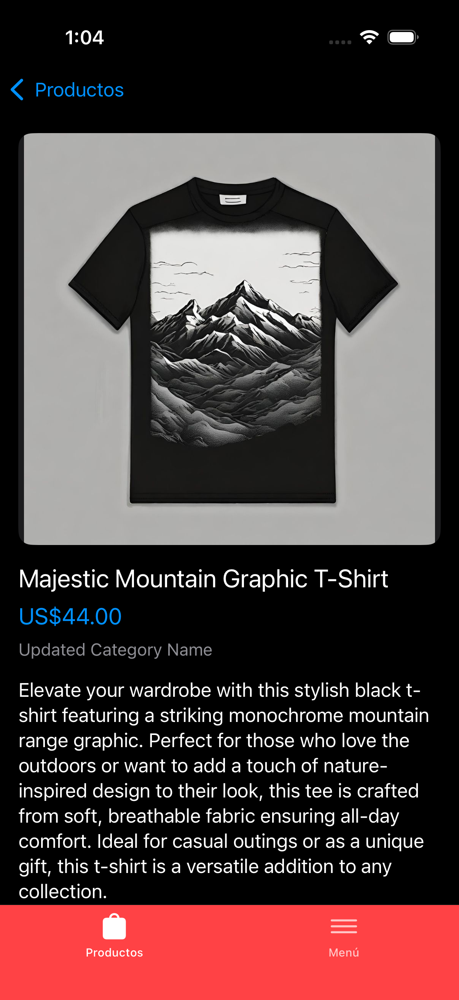
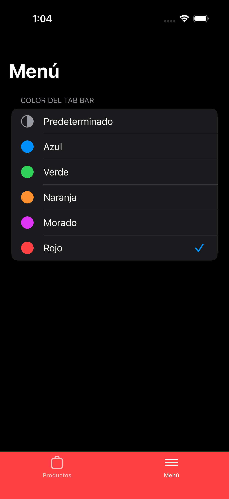

# ibk-products

## Descripción

Aplicación iOS que lista productos desde la [Platzi Fake Store API](https://fakeapi.platzi.com/en/rest/products/). Tiene dos pestañas:

- **Productos:** listado paginado que muestra solo el nombre de cada producto. Al seleccionar uno se abre su detalle con imagen, nombre, precio, categoría y descripción.
- **Menú:** permite cambiar el color de fondo del tab bar. El color elegido se guarda como preferencia y se mantiene al volver a abrir la app.

La app está hecha con UIKit, con la interfaz en código, y funciona en iPhones.

## Arquitectura

La app usa **MVVM + Coordinator** y separa el código en capas:

- **Presentation Layer:** ViewControllers, ViewModels y Coordinators (`App/` y `Features/`).
  - Los **ViewControllers** solo dibujan la interfaz y envían las acciones del usuario al ViewModel.
  - Los **ViewModels** tienen el estado de cada pantalla (`@Published`) y la lógica de presentación (paginación, estados de carga, vacío y error, formato del precio). No importan UIKit, por eso se pueden probar con tests unitarios.
  - Los **Coordinators** manejan la navegación. Los ViewModels no los conocen: les avisan mediante closures (por ejemplo `onProductSelected`).

- **Domain Layer:** modelos y contratos del negocio (`Core/Domain/`).
  - `Product`: el modelo que usa toda la app.
  - `ProductRepository`: el protocolo que consume la capa de presentación, sin saber de dónde vienen los datos.

- **Data Layer:** implementaciones de acceso a datos (`Core/Data/`).
  - `Network/`: `HTTPClient` (basado en `URLSession` y Combine), `Endpoint` y `NetworkError`.
  - `DTOs/`: `ProductDTO`, que refleja el JSON de la API y se convierte a `Product` con `toDomain()`.
  - `Repositories/`: `RemoteProductRepository`, la implementación de `ProductRepository` contra la API.
  - `Storage/`: `PreferencesStore`, que guarda el color del tab bar en `UserDefaults`.

- **Theme:** `TabBarColor` y `ThemeService` (`Core/Theme/`), que guardan el color elegido y avisan de los cambios al tab bar y al Menú.

Las dependencias se crean en `AppContainer` (`App/DI/`) y se inyectan por `init`, lo que permite reemplazarlas por mocks en los tests.

### Flujo de la app

```
SceneDelegate → AppCoordinator → MainTabBarController
                                 ├─ ProductsCoordinator → ProductListViewController → ProductDetailViewController
                                 └─ MenuCoordinator     → MenuViewController
```

```
API → HTTPClient → RemoteProductRepository → ViewModel (@Published) → ViewController
```

### Estructura de carpetas

```
ibk-products/
├── App/                  AppDelegate, SceneDelegate, MainTabBarController
│   ├── Coordinators/     Coordinator, AppCoordinator
│   └── DI/               AppContainer
├── Core/
│   ├── Domain/           Models (Product), Repositories (ProductRepository)
│   ├── Data/             DTOs, Repositories, Network, Storage
│   └── Theme/            TabBarColor, ThemeService
├── Features/
│   ├── Products/         ProductsCoordinator, List/ y Detail/ (ViewController + ViewModel)
│   └── Menu/             MenuCoordinator, MenuViewController, MenuViewModel
└── Resources/            Assets
ibk-productsTests/        Tests unitarios de los ViewModels y mocks
```

## Instalación y ejecución

### Requisitos previos

- Mac con [Xcode 26.1](https://developer.apple.com/xcode/) o superior.
- Simulador o dispositivo con iOS 17 o superior.
- Opcional: [SwiftLint](https://github.com/realm/SwiftLint) para ver las reglas de estilo al compilar.

```bash
# instalar SwiftLint (opcional)
brew install swiftlint
```

### Instalación

Después de clonar el repositorio desde la rama `main`, abre una consola en la carpeta del proyecto:

```bash
# moverse a la carpeta del proyecto
cd ibk-products
```

Luego abre el proyecto en Xcode:

```bash
# abrir el proyecto en Xcode
open ibk-products.xcodeproj
```

Xcode descarga automáticamente las dependencias de Swift Package Manager la primera vez que abres el proyecto.

### Uso

Con el proyecto abierto, elige un simulador de iPhone y ejecuta la app.

### Tests

Los tests unitarios cubren los ViewModels de la lista de producto, el detalle y el Menú. Para correrlos ejecuta:

```bash
xcodebuild test -project ibk-products.xcodeproj -scheme ibk-products \
  -destination 'platform=iOS Simulator,name=${nombre_de_simulator}'
```

## Imágenes de la app

<table>
    <tr>
        <th>Lista de productos</th>
        <th>Detalle del producto</th>
        <th>Menú</th>
    </tr>
	<tr>
        <td></td>
        <td></td>
        <td></td>
	</tr>
</table>

<table>
    <tr>
        <th>Lista de productos (oscuro)</th>
        <th>Detalle del producto (oscuro)</th>
        <th>Menú (oscuro)</th>
    </tr>
	<tr>
        <td></td>
        <td></td>
        <td></td>
	</tr>
</table>

## Construido con

- [Swift 5](https://developer.apple.com/swift/) - Lenguaje de programación (modo de lenguaje Swift 5, compilado con Swift 6.2)
- [UIKit](https://developer.apple.com/documentation/uikit) - Framework de interfaz, con vistas en código
- [Combine](https://developer.apple.com/documentation/combine) - Programación reactiva entre capas
- [REST](https://www.redhat.com/es/topics/api/what-is-a-rest-api) - Consumo del servicio web
- [CombineExt](https://github.com/CombineCommunity/CombineExt) - Operadores adicionales de Combine
- [SDWebImage](https://github.com/SDWebImage/SDWebImage) - Descarga y caché de imágenes
- [XCTest](https://developer.apple.com/documentation/xctest) - Tests unitarios
- [SwiftLint](https://github.com/realm/SwiftLint) y [swift-format](https://github.com/swiftlang/swift-format) - Estilo y formato del código
